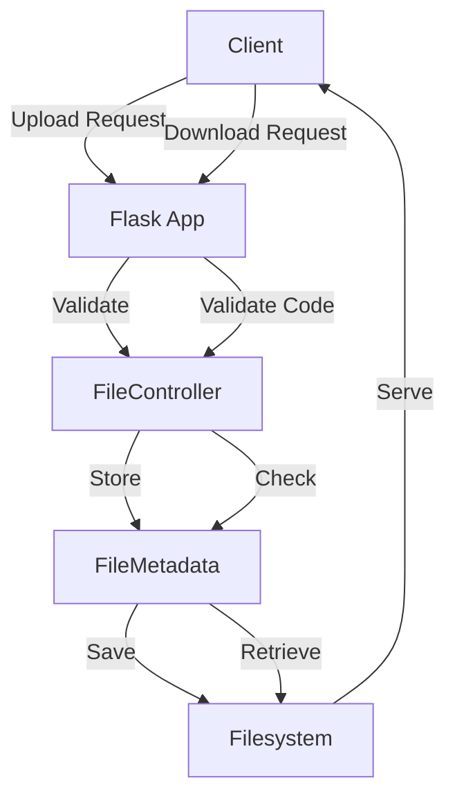
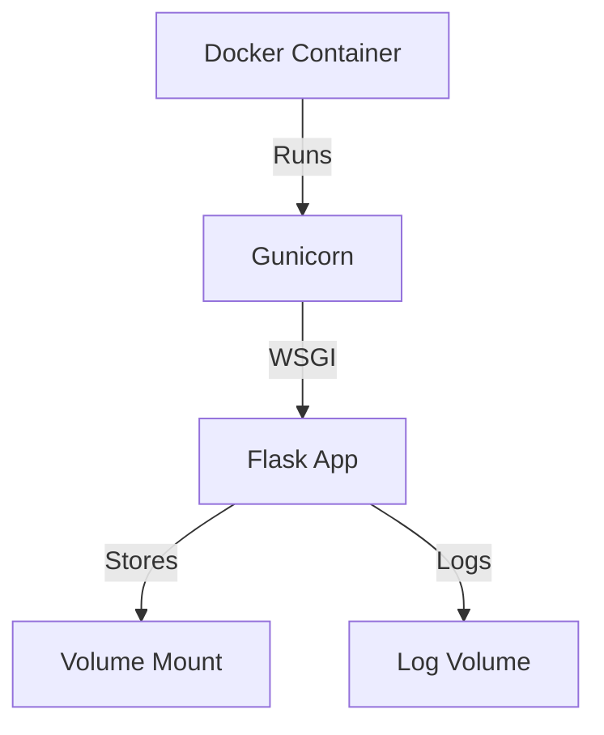

# System Architecture

## Overview
The Simple File Upload Server is built using a Model-View-Controller (MVC) architecture pattern in Flask, with clear separation of concerns and modular design. The system handles both traditional file uploads and chunked uploads for large files, with a focus on security and reliability.

## System Components

### 1. Core Architecture (MVC)

#### Models (`src/models/`)
- **FileMetadata**
  - Handles file metadata management
  - Tracks download counts, expiry times
  - Manages file paths and access codes
  - Implements cleanup for expired files

#### Views (`src/templates/`)
- **index.html**
  - Modern, responsive UI for file downloads
  - Client-side validation
  - Progress tracking
  - Error handling
- **error.html**
  - User-friendly error pages
  - Contextual error messages
  - Clean, responsive design

#### Controllers (`src/controllers/`)
- **file_controller.py**
  - Upload/download logic
  - Chunked upload management
  - File cleanup operations
  - Access code generation

### 2. Data Flow



### 3. File Storage System

#### Directory Structure
```
tmp/
├── uploads/
│   ├── [regular files]
│   └── chunks/
│       └── [upload_session_folders]/
```

#### Metadata Storage
- `file_metadata.json`: Tracks regular file uploads
- `chunk_metadata.json`: Manages chunked upload sessions

### 4. Security Architecture

#### Authentication
- API key authentication for uploads
- 6-digit alphanumeric codes for downloads
- SSL/TLS support for secure transmission

#### File Security
- Secure filename sanitization
- Temporary storage with auto-cleanup
- Download limit enforcement
- File expiry system

### 5. Chunked Upload System

#### Components
1. **Session Management**
   - Unique upload session IDs
   - Chunk tracking and verification
   - Progress monitoring

2. **File Assembly**
   ```mermaid
   graph LR
       A[Client] -->|Chunks| B[Temporary Storage]
       B -->|Assembly| C[Final File]
       C -->|Metadata| D[Database]
   ```

3. **Cleanup Process**
   - Automatic cleanup of abandoned uploads
   - Temporary file management
   - Session expiry handling

### 6. Logging System (`src/utils/mLogger.py`)

#### Logging Levels
- INFO: Normal operations
- WARNING: Potential issues
- ERROR: Operation failures
- DEBUG: Development information
- VERBOSE: Detailed tracking

#### Log Format
```
timestamp|level|module::message
```

### 7. Error Handling

#### Types of Errors
1. **Client Errors**
   - Invalid file types
   - Missing parameters
   - Authentication failures
   - Invalid codes

2. **Server Errors**
   - Storage issues
   - File assembly failures
   - Database errors
   - Network timeouts

#### Error Response Format
```json
{
    "error": "Error description",
    "details": "Additional information"
}
```

### 8. Configuration System

#### Environment Variables
- `CLIENT_KEY`: API authentication
- `UPLOAD_FOLDER`: File storage location
- `SSL_CERT`: SSL certificate path
- `SSL_KEY`: SSL key path

#### Application Constants
- Maximum file size
- Chunk size limits
- Session timeouts
- Cleanup intervals

## Performance Considerations

### 1. Resource Management
- Chunked upload for large files
- Temporary storage cleanup
- Memory-efficient file handling
- Connection timeout management

### 2. Scalability
- Stateless design
- File system abstraction
- Configurable worker processes
- Independent upload sessions

### 3. Network Optimization
- Adaptive chunk sizes
- Progress tracking
- Resume capability
- Connection monitoring

## Deployment Architecture

### Docker Container


### Process Management
- Gunicorn worker processes
- Configurable timeouts
- SSL termination
- Health monitoring

## Future Architecture Considerations

### Planned Improvements
1. **Monitoring System**
   - API usage metrics
   - Storage utilization
   - Error rate tracking
   - Performance monitoring

2. **Enhanced Security**
   - Rate limiting
   - IP whitelisting
   - File type restrictions
   - Access audit logging

3. **High Availability**
   - Load balancing
   - Redundant storage
   - Session persistence
   - Backup management